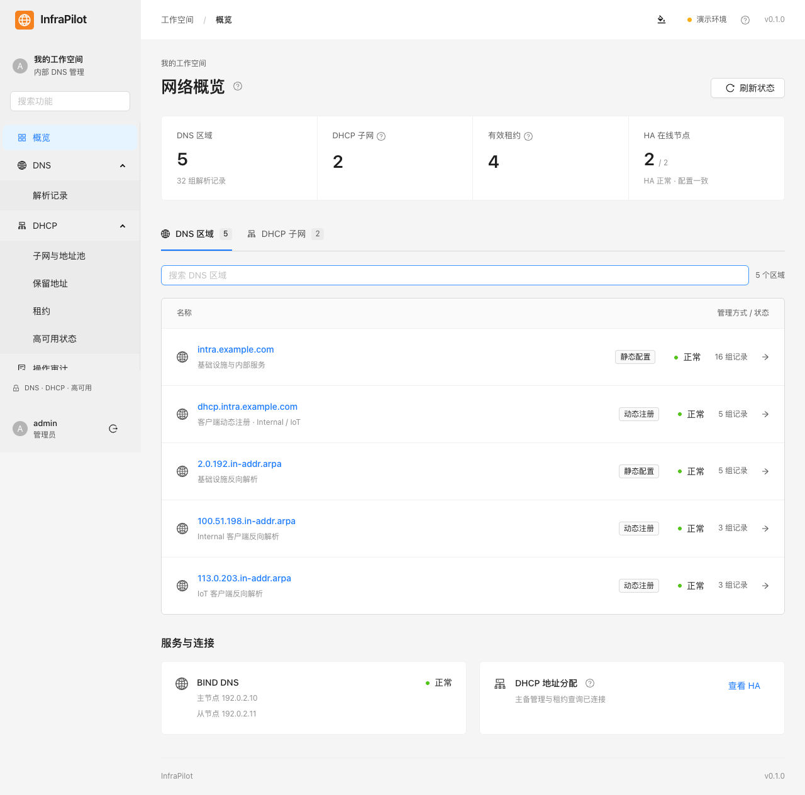
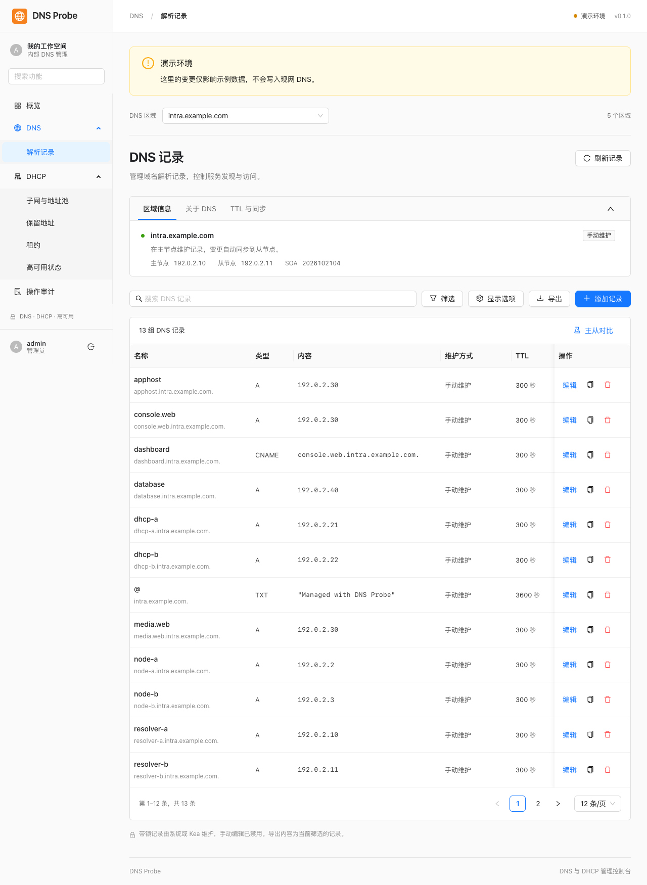

# DNS Probe

基于 **Java 21 / Spring Boot + Vue 3 / Ant Design Vue** 的 BIND DNS 记录管理面板，前后端独立构建、独立部署。

通过 AXFR 读取区域，使用 RFC2136 + TSIG 原子更新记录集。BIND 继续负责主从同步和 DNSSEC 签名；Kea 继续管理客户端 DDNS。





## 已实现

- Session 登录、CSRF 防护，管理员和只读用户；账号凭据通过环境变量配置。
- 区域概览、记录搜索、类型筛选、系统记录显示开关。
- A / AAAA / CNAME / MX / TXT / PTR / SRV / CAA 记录集增删改、TTL、多值编辑及提交前预览。
- 修改前校验记录版本，DNS UPDATE 携带旧记录集前置条件，未签名区域额外校验 SOA；检测到并发冲突返回 409。
- Kea 区域只读，DHCID 名称、DNS 系统记录及已委派子域保护。生产中需同时配置 BIND 侧权限。
- 主从实际 DNS 查询对比：回答、SOA 序列号、响应耗时和错误信息。
- 持久化变更审计，包括修改前后内容、操作人、时间、PENDING / SUCCESS / FAILED 状态。
- Docker Compose、接入模板、后端测试、浏览器端到端测试和 GitHub Actions。
- 独立演示模式：数据只保存在演示后端内存中；重启重置 DNS 示例数据，审计日志单独持久化。

当前不管理 BIND 全局配置、TSIG 密钥、DNSSEC 密钥、区域创建/删除或主从提升；不包含 Kea 租约修改。A 与 PTR 是不同区域的独立操作，不提供跨区域事务或自动 PTR 联动。

## 本地启动

需要 Java 21+、Maven 3.9+、Node.js 22.12+。不需要本机 BIND。

```sh
# 终端一
cd backend
mvn spring-boot:run

# 终端二
cd frontend
npm ci
npm run dev
```

打开 http://127.0.0.1:5173 。开发服务器将 `/api` 代理到后端 8080，前端不存储密码或访问令牌。

默认是演示模式。点击「填入演示账户」后登录，或使用 `admin / dns-probe-demo`。该默认密码仅在演示模式可用；生产模式要求显式提供不少于 16 字符的管理员密码。

## Docker Compose

```sh
# 例如部署到 /opt/ryanbuu/dns-probe
git clone git@github.com:ryanbuu/dns-probe.git /opt/ryanbuu/dns-probe
cd /opt/ryanbuu/dns-probe
cp .env.example .env
docker compose up -d --build
```

默认访问 http://127.0.0.1:8088 。前端 Nginx 与 Java 后端为两个容器，只有前端发布端口；`audit-data` 卷保存审计数据库。应用容器以非 root 用户运行。

接入实际 BIND：

1. 先按 [BIND 接入说明](docs/BIND-INTEGRATION.md) 创建专用 TSIG 身份、授权 AXFR 和精确的更新权限；保留现有 Kea 身份及主从配置。
2. 复制 `deploy/application-live.example.yml` 到 `deploy/config/application.yml`，检查区域、主从地址、只读策略和密钥名称。
3. 修改 `.env`，设置 `DNS_MODE=live`、`DNS_WEB_TSIG_SECRET` 以及独立的管理员密码；生产配置和 `.env` 均已被 Git 忽略。
4. HTTPS 反代部署时设置 `SESSION_COOKIE_SECURE=true`，由现有 APISIX 将指定域名转发到前端发布端口。按反代所在网络配置 `LISTEN_ADDRESS`，默认只监听本机。
5. `docker compose up -d --build`。先核对区域读取、只读保护、测试记录及从节点同步，再交付日常使用。

仓库没有包含任何现网 API Key、SSH 私钥或 TSIG 密钥。公开示例与截图使用 RFC 5737 文档地址及 example.com 域名；应用不会自动修改 BIND 权限。

## 验证

```sh
mvn -f backend/pom.xml verify
npm --prefix frontend ci
npm --prefix frontend run build
cd frontend
npx playwright install chromium  # CI / Linux；macOS 本地测试默认使用已安装的 Chrome
npm run test:e2e
```

浏览器测试启动隔离的内存数据库后端和开发前端，验证登录、记录新增/修改/删除、变更预览、只读区域、主从对比、审计与手机导航。后端测试覆盖实际 TCP DNS 报文、TSIG、AXFR、UPDATE 前置条件、冲突、权限和写入失败路径。这些测试不写生产 DNS，也不等同于现网 BIND 接入验收。

CI 以 Java 21 和 Node.js 22 构建、测试。测试截图使用演示数据。

## 配置和运行

- `DNS_MODE`：`demo` 或 `live`；未知模式或缺少生产区域/密钥/管理员密码会拒绝启动。
- `DNS_ADMIN_USERNAME` / `DNS_ADMIN_PASSWORD`：管理员；修改环境变量后重启后端生效。
- `DNS_VIEWER_USERNAME` / `DNS_VIEWER_PASSWORD`：可选只读账号，密码为空则不创建。
- `SESSION_COOKIE_SECURE`：HTTPS 下应为 `true`。
- 默认审计数据库为 `jdbc:h2:file:./data/dns-probe`；可通过 `DATABASE_URL`、`DATABASE_USERNAME`、`DATABASE_PASSWORD` 切换 PostgreSQL。首次启动自动创建审计表，部署前应为 PostgreSQL 准备独立数据库和最小权限账号。
- 数据库不可写时不会发送新的 DNS 更新。DNS 已成功但最终审计落盘失败时返回明确错误，原意图保持 PENDING，需查询实际记录核实；DNS 更新与数据库不是分布式事务。
- 网络超时可能意味着更新已到达 BIND，不能确认结果时不要盲目重试，先刷新记录。
- 只读用户可浏览区域及查询主从，不能写记录或读取审计。
- DNS 服务器地址、端口和密钥仅由后端部署配置决定，不能通过浏览器任意指定。

停止面板不会停止 BIND、Kea 或现有区域同步。应用只管理记录，不接管 DNS 服务。

[API 说明](docs/API.md) · [BIND 接入说明](docs/BIND-INTEGRATION.md)

前端使用 Ant Design Vue 默认主题；不覆盖组件配色、圆角、字号和状态样式，仅保留应用布局与响应式尺寸适配。
